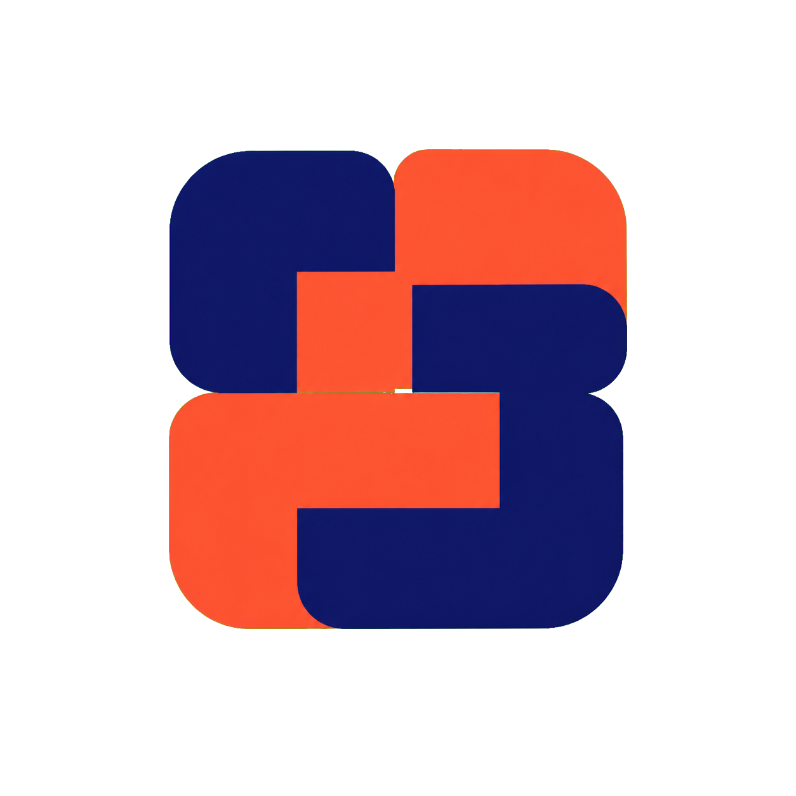
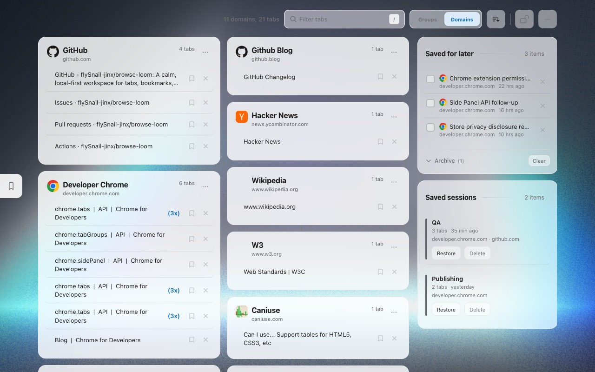
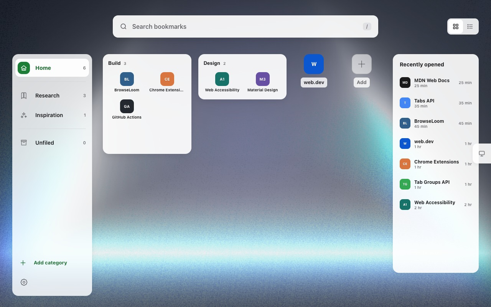
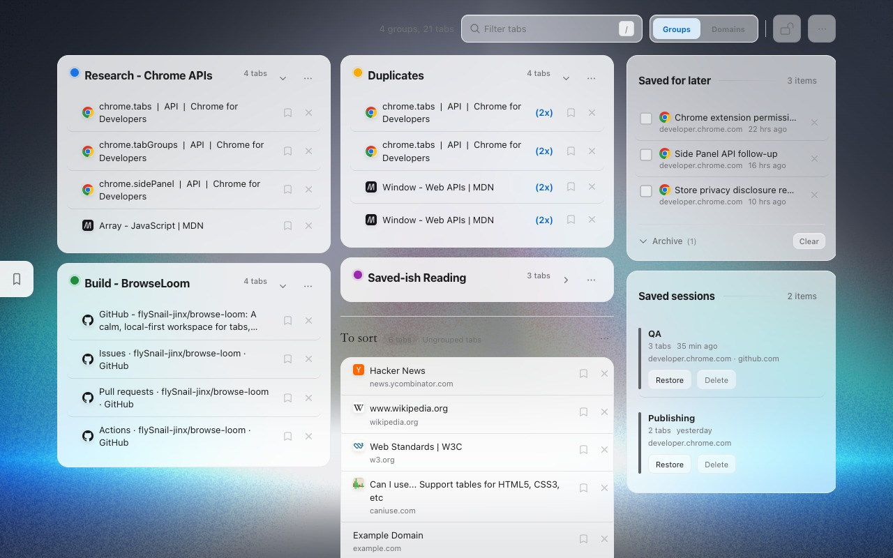
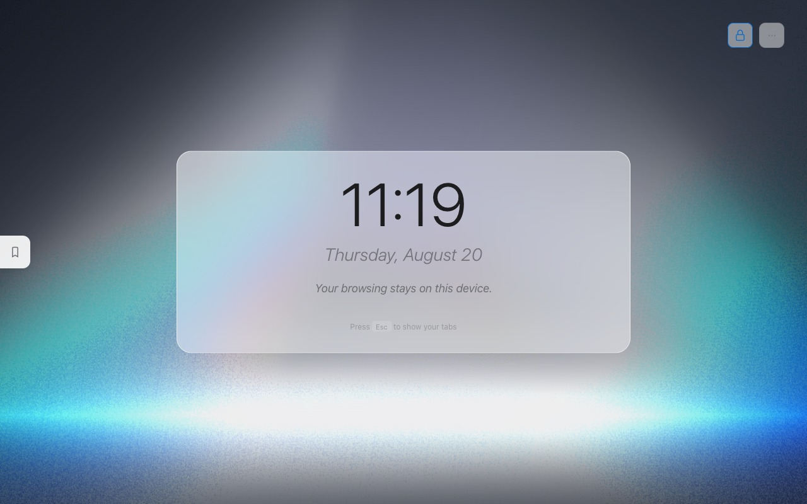
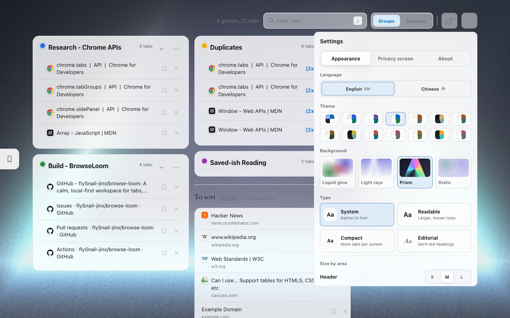

<div align="center">



# BrowseLoom

</div>

[English](./README.md) · 简体中文

**一个安静、本地优先的 Chrome 浏览工作台。**

BrowseLoom 把打开的标签页、Chrome 原生 Tab Groups、浏览器书签、已保存会话和稍后阅读内容集中到一个可视化工作区。它会替换默认新标签页，并提供可选侧边栏、固定标签保护和本地数据存储。

不需要服务器。不需要账号。不做遥测。没有构建步骤。加载 `extension/` 文件夹即可使用。

最低要求 Chrome 116。Edge、Brave 在具备同等 Manifest V3 能力时可能可用，但不属于发布承诺。

**开发状态**：1.2.0 已实现原生书签管理和旧书签直接导入；商店上线状态以审核结果为准。下方旧版宣传截图尚未更新。

版本记录见 [`CHANGELOG.zh-CN.md`](./CHANGELOG.zh-CN.md)。

---

## 核心优势

- **文字优先的控制台布局**：新标签页层级更清楚，右上角控件更集中，页头不再重复品牌名称。
- **原生书签浏览（第一阶段）**：授权后直接显示当前浏览器的书签树，支持多层文件夹、面包屑、名称/网址搜索、网格/列表和默认文件夹。
- **跟随浏览器变化**：在原生书签管理器中修改后页面自动刷新；可通过项目的“…”或右键菜单移动、删除书签和文件夹；工具栏支持新增书签和文件夹，项目菜单支持编辑和重命名；浏览器顺序下可拖拽排序，也可拖入目录。
- **保护旧书签**：在“旧插件书签 → 直接导入 Chrome”中选择目标后点击“全部导入”，按原分类和文件夹结构完整复制，无需逐条勾选；原有重复条目也会保留。导入进度可继续、失败项可重试；旧库与备注保留，无需先导出。JSON 备份是可选项，卸载前请备份插件专有字段。书签本身是否同步取决于浏览器账户和保存位置。
- **两种组织方式**：可在域名分组和 Chrome 原生 Tab Groups 视图之间切换。
- **快速过滤标签**：按 `/` 后可实时过滤卡片、标签、URL 和分组名。
- **搜索过滤语法**：支持 `domain:`、`group:`、`url:` 和 `saved:`，并高亮匹配内容。
- **侧边栏标签中心**：不离开当前网页也能搜索、跳转、稍后再看、关闭、清理重复、恢复最近关闭标签，并保存当前窗口或全部窗口。
- **快捷键与地址栏入口**：在地址栏输入 `loom` 可搜索或执行动作，也可用 commands 打开侧边栏、保存会话和切换隐私模式。
- **无障碍与动效控制**：图标按钮补齐可访问标签，标签 chip 支持键盘触发，并尊重系统减少动态效果设置。
- **适合屏幕共享的隐私模式**：点击锁图标或按 `Esc`，把标签面板隐藏成简洁的时钟屏幕。
- **固定标签保护**：固定标签不会出现在卡片、统计、重复清理或批量关闭动作中。
- **一键清理重复页**：重复 URL 会被标记，可一键保留一份并关闭多余副本。
- **稍后再看**：关闭前可把标签保存到本地清单。
- **自动刷新**：打开、关闭、跳转标签以及分组变化都会自动刷新面板。
- **中英文界面**：可在设置中切换 English / 简体中文。
- **更多主题，更好切换**：内置 14 套主题，并集中在轻量设置面板中。
- **可切换的本地背景**：可选流光液体、光束、棱镜或低功耗静态背景；只运行当前选中的渲染器，选择仅保存在本机。
- **本地优先的隐私策略**：设置和保存的标签都留在你的机器上；外部网站图标默认关闭，只有用户看到域名传输说明并主动开启后才会请求 DuckDuckGo。

---

## 界面与控件



标签工作台把打开的页面整理成便于浏览的卡片，同时保留稍后阅读和已保存会话。这组截图由当前扩展在干净浏览器配置中实拍，内容全部来自公开演示页面。

右上角控件保持紧凑：

- **锁图标**：切换隐私模式。
- **设置**：打开语言、主题、背景、字体和隐私屏幕选项。

内置主题：

| 主题 | 风格 |
| --- | --- |
| 随光 | 跟随 Chrome/Edge 的浅色或深色外观 |
| 素笺 | 极简白色工作台 |
| 星轨 | 清爽的 Material 风格配色 |
| 雾岸 | 柔和的 Cupertino 玻璃感 |
| 暖笺 | 柔和的编辑纸感 |
| 夜航 | 安静的深色工作区 |
| 霜原 | 清爽蓝白 |
| 森屿 | 低饱和绿与大地色 |
| 墨金 | 石墨深色 + 金色强调 |
| 珊潮 | 海岸青绿 + 珊瑚色 |
| 梅影 | 低饱和李子色 |
| 茶岚 | 护眼绿色阅读模式 |
| 烬岩 | 深石板 + 暖色能量 |
| 薰风 | 浅薰衣草 + 薄荷色 |

当前产品界面：

| 书签工作台 | Chrome 分组 |
| --- | --- |
|  |  |

| 隐私模式 | 外观设置 |
| --- | --- |
|  |  |

---

## 安装

1. 克隆仓库：

```bash
git clone https://github.com/flySnail-jinx/browse-loom.git
cd browse-loom
```

2. 打开浏览器扩展管理页：

```text
chrome://extensions
edge://extensions
brave://extensions
```

3. 打开 **开发者模式**。
4. 点击 **加载已解压的扩展程序**。
5. 选择本仓库里的 `extension/` 文件夹。
6. 打开一个新标签页。

后续更新时，拉取最新代码后在扩展管理页点击 **重新加载**：

```bash
git pull
```

---

## 调试

日常手动测试时，优先使用 Chrome，并在 `chrome://extensions` 中加载本仓库的 `extension/` 文件夹。

自动化扩展测试建议使用 **Chrome for Testing**，不要依赖普通品牌版 Chrome。新版品牌版 Chrome 可能会阻止通过命令行加载已解压扩展，而 Chrome for Testing 仍保留这类自动化调试能力。

本工作区可以把本地浏览器二进制放在：

```text
tools/chrome-for-testing/
```

这个目录体积较大，只用于本地调试，已被 Git 忽略。它不会进入 Chrome Web Store / Edge Add-ons 的 zip 包。

启动当前本地扩展：

```bash
npm run dev:host
```

脚本默认会在每次启动时准备一组可重复的手动回归场景：置顶主页、重复 URL、原生 Chrome Tab Groups、折叠分组、混合未分组标签页、最近关闭标签页、稍后再看条目、已保存会话、活动统计和成就。再次运行 `npm run dev:host` 时会先清理上一轮 seed 出来的标签页，再重新创建，避免测试标签越堆越多。

需要干净浏览器时使用 `scripts/launch-chrome-testing.sh --no-seed-tabs`，需要重置测试资料并重新生成场景时使用 `--reset-profile`。

可选覆盖环境变量：`CHROME_BIN`、`PROFILE_DIR`、`REMOTE_DEBUGGING_PORT`、`SEED_TABS`、`SEED_DELAY_MS`、`SEED_CLEANUP`、`SEED_REQUIRED`。

## 校验

扩展仍然不需要构建步骤，但仓库现在提供轻量本地检查：

```bash
npm test
npm run validate
```

`npm run validate` 会先重新生成两个商店 ZIP，再检查 `manifest.json`、脚本语法、服务加载顺序、ZIP 精确白名单，以及包内每个文件与当前源码的 SHA-256 内容是否一致。

---

## 快捷键

| 按键 | 动作 |
| --- | --- |
| `/` | 聚焦标签过滤框 |
| 标签过滤框聚焦时按 `Esc` | 清空并取消聚焦 |
| 其他位置按 `Esc` | 切换隐私模式 |
| `Ctrl/Cmd + Shift + G` | 切换 Groups / Domains 视图 |
| `Ctrl/Cmd + Shift + Y` | 打开 Side Panel |
| `Ctrl + Shift + D` | 进入书签页并提示使用浏览器收藏星标（页面内收藏待后续阶段恢复） |
| `Ctrl + Shift + Z` | 在 BrowseLoom 与刚才查看的标签页之间往返 |

地址栏关键字：输入 `loom` 后接查询或动作，例如 `panel`、`save-session`、`dedupe`、`privacy`。

---

## 功能说明

### 标签面板

BrowseLoom 通过 `chrome.tabs.query({})` 读取打开的标签，过滤浏览器内部页面，并渲染为更容易操作的卡片：

- 普通网页按域名组成卡片
- Gmail、X、YouTube、LinkedIn、GitHub 等首页归入 Homepages 卡片
- 可切换到 Chrome Tab Groups 视图
- 重复 URL 会显示重复标记
- localhost 会显示端口号，方便区分本地项目
- 点击标签页查看后，可用 `Ctrl + Shift + Z` 在目标标签与控制台之间往返；浏览器会话内只在内存中暂存标签页/窗口 ID

### 搜索

搜索框使用同一个本地索引覆盖打开标签、Chrome 分组标题、稍后再看条目和已保存会话。支持的过滤语法：

| 过滤 | 示例 |
| --- | --- |
| `domain:` | `domain:github auth` |
| `group:` | `group:work api` |
| `url:` | `url:docs extensions` |
| `saved:` | `saved:true article` 或 `saved:false github` |

### Side Panel

侧边栏让你停留在当前网页时也能使用 BrowseLoom：

- 搜索打开的标签、稍后再看条目和已保存会话
- 通过 `Ctrl/Cmd + Shift + Y` 或 `loom panel` 等地址栏动作打开
- 跳转到标签、保存稍后再看或关闭标签
- 清理重复标签并保留一份
- 通过 `chrome.sessions` 恢复浏览器最近关闭的标签/窗口
- 默认保存当前窗口，也可显式保存全部窗口
- 查看 Tab Health、本周统计、常见域名和整理成就

### Chrome Tab Groups

域名卡片可以创建原生 Chrome Tab Groups。分组卡片支持重命名、改色、折叠/展开、解除分组和保存为会话。固定标签不会进入会话；会话会保留窗口结构但不保存 Chrome 窗口 ID。恢复默认合并到当前窗口，也可显式按原窗口结构重新创建窗口。

### 关闭逻辑

关闭动作使用精确 URL 匹配，范围只覆盖当前卡片展示的标签，避免误关同域名下的无关页面。

所有批量关闭和重复清理动作都会跳过固定标签。

### 稍后再看

点击“稍后再看”按钮会先把标签保存到 `chrome.storage.local`，再关闭标签。保存的条目只存在本地，并可勾选归档。

### 隐私模式

隐私模式会隐藏标签面板，显示简洁的时钟和日期界面，适合屏幕共享或录屏前使用。你可以自定义是否显示：

- 时钟
- 日期
- 自定义文字
- 外部 favicon 请求

### 主题与语言

主题选择保存在 `localStorage`，并在页面绘制前应用，避免刷新时闪回默认主题。

语言选择同样保存在本地并提前应用。语言切换只影响固定 UI 文案；标签标题、URL、Chrome 分组名称和用户输入的文字不会被翻译或改写。

---

## 隐私说明

BrowseLoom 采用本地优先设计。

外观设置支持导入最多 10 张本机 JPEG、PNG 或 WebP 壁纸。用户可以调整每张壁纸的焦点和遮罩强度；图片及设置仅保存在当前浏览器配置中。

本地保存的数据包括：

- 稍后再看的标签
- 隐私模式状态与设置
- 视图模式
- 语言选择
- 主题选择
- favicon 缓存
- 搜索联想偏好（旧搜索引擎设置保留存储，但不再用于决定搜索去向）
- 个人壁纸图片、缩略图、焦点与遮罩设置

原生书签优先通过浏览器内部图标接口展示网站 Logo（`favicon` 权限）。接口失败时可复用插件缓存，或在用户已开启联网取图标时使用外部服务；否则显示通用网站图标。

外部 favicon 请求可在隐私设置中关闭。关闭后，已缓存的 favicon 仍可显示，但新域名不会请求图标服务。

按用户选择启用的外部请求包括：

- `icons.duckduckgo.com`，用于获取 favicon，并在本地缓存 7 天
- `suggestion.baidu.com`，仅在用户开启百度联想并使用任意网页搜索引擎输入时获取联想词；请求不携带凭据

扩展不使用 Google Fonts，字体来自系统字体栈。

本地标签页和书签筛选不会发起外部搜索请求。隐私模式会隐藏工作区，但不会修改用户选择的搜索来源。

商店上传包通过 `npm run package` 生成在本地 `dist/` 目录。Chrome 包是正式支持的发布产物；Edge 包只作为能力兼容的便利产物。ZIP 文件会被 Git 忽略，不应提交到 GitHub。

---

## 权限说明

扩展当前请求以下权限：

| 权限 | 用途 |
| --- | --- |
| `tabs` | 读取、聚焦、关闭和分组打开的标签 |
| `storage` | 保存稍后再看、会话、统计、隐私设置和视图模式 |
| `tabGroups` | 读取、展示、创建、更新、折叠和取消 Chrome Tab Groups |
| `sidePanel` | 显示侧边栏控制台 |
| `sessions` | 展示并恢复最近关闭的浏览器标签/窗口 |
| `bookmarks`（可选） | 用户连接后读取原生书签树并监听变化；用户确认移动、删除或导入后修改浏览器书签，可在设置中撤销授权 |
| `suggestion.baidu.com`（可选主机） | 仅在用户开启百度在线联想后，为网页搜索模式获取联想词 |

---

## 技术栈

| 项目 | 实现 |
| --- | --- |
| 扩展平台 | Chrome Manifest V3 |
| UI | 原生 HTML、CSS、JavaScript |
| 存储 | `chrome.storage.local` 和 `localStorage` |
| 音效 | Web Audio API |
| 动画 | CSS transitions 和 JavaScript 粒子 |
| 构建 | 无 |

所有核心逻辑都在本地扩展内运行。后台 service worker 负责浏览器级入口，包括工具栏网页收藏、角标、commands、地址栏动作、侧边栏和轻量会话动作。

---

## 致谢与许可

BrowseLoom 按 Apache License 2.0 分发。

本项目是基于 **Sivan** 的 **[Super Tab Out](https://github.com/SivanCola/super-tab-out)** 的衍生作品，上游采用 Apache-2.0。Super Tab Out 又包含对 **Zara Zhang** 的 **[Tab Out](https://github.com/zarazhangrui/tab-out)** 的修改部分，Tab Out 使用 MIT License。

Apache-2.0 协议全文位于 [`LICENSE`](./LICENSE)。上游 MIT 的必要版权和许可声明保留在 [`NOTICE`](./NOTICE)。请不要从实质性复制或分发版本中移除这些声明。

本分叉在此基础上加入了安全加固、Manifest V3 更新、跨浏览器新标签识别、固定标签保护、Chrome Tab Groups 视图、中英文界面、扩展主题、隐私模式、标签过滤、favicon 缓存以及本地优先的稍后再看流程。

本项目不隶属于 Google、Chrome、Microsoft Edge、Brave、DuckDuckGo 或任何上游作者。相关产品名和服务名仅用于说明兼容性或必要署名。

Apache-2.0。详见 [`LICENSE`](./LICENSE) 和 [`NOTICE`](./NOTICE)。
